# Kayn Combat Diagnostics 1.5.0

A **standalone combat diagnostics mod for Starsector 0.98a-RC8**. No other mods
or libraries required. Observe your ship or a selected ship, check weapon activity,
and save session reports. It does not change ship behaviour or weapon AI.

## Install

1. Download the **KaynCombatDiagnostics-1.5.0.zip** mod package from [Releases](https://github.com/MysticEntry-Nova64/KaynCombatDiagnostics/releases/latest).
2. Extract the `KaynCombatDiagnostics` folder into your `Starsector/mods` folder.
3. Check that `Starsector/mods/KaynCombatDiagnostics/mod_info.json` exists.
4. Enable **Kayn Combat Diagnostics** in the Starsector launcher and start the game.
5. Enter combat and press **Ctrl+F8** to begin.

Use the mod ZIP; GitHub's **Source code** downloads require a local build.

## Shortcuts

| Shortcut | Action |
| --- | --- |
| **Ctrl+F8** | Start a fresh measurement or stop and archive the current one. |
| **Ctrl+F9** | Pin your selected friendly/enemy ship; press again to follow your controlled ship. With no target, stay on your ship. |
| **Ctrl+F10** | Next weapon page (six weapons per page). |
| **Ctrl+F7** | Show or hide help while diagnostics are enabled. |
| **Ctrl+Up / Ctrl+Down** | Scroll the panel. |

Diagnostics start off each battle. Rebind shortcuts in the mod's
`data/config/settings.json`, then restart the game.

## Features

### Weapon activity

Shows firing activity, projectile and impact counts, plus beam firing time and hit frames. Counts cover the current measurement, not trigger pulls.

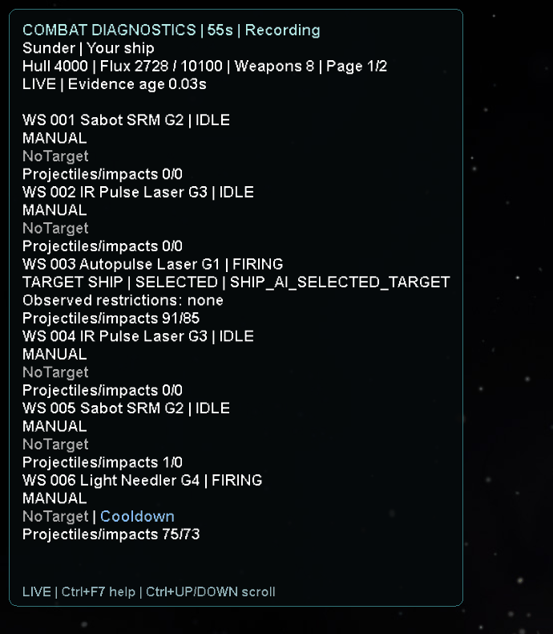

### Shot directions

Keeps the last five observed projectile directions per weapon, fading from green to black. Lines stay at their original world position.

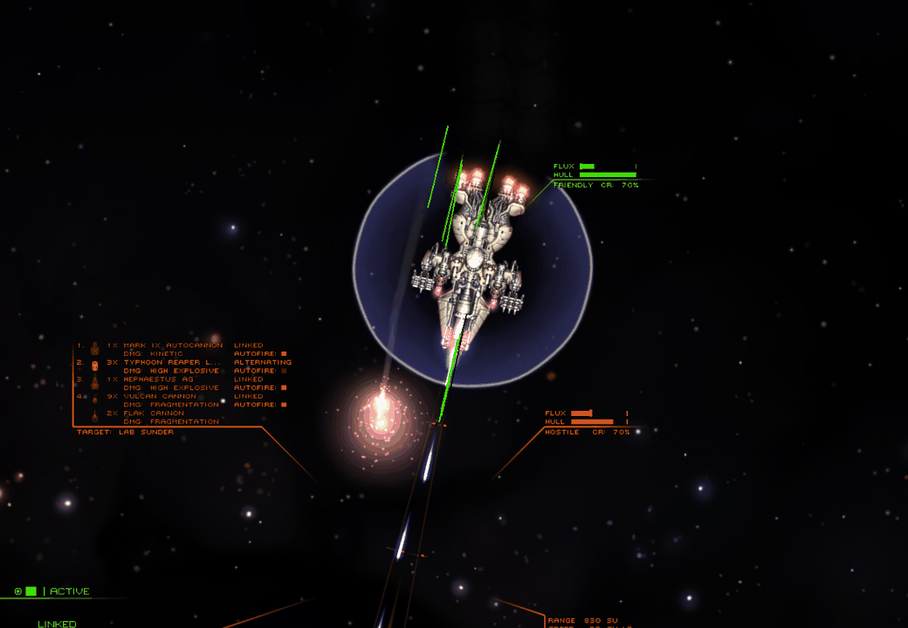

### Ship status and session timer

Displays hull, current/max flux, weapon count, recording status and elapsed simulation time.

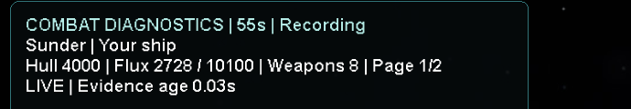

### Follow different ships

Automatically follows your controlled ship. Switching ships archives the previous measurement and resets counters.

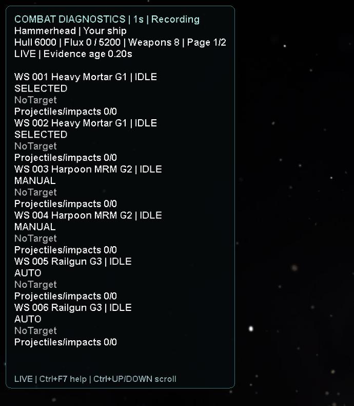

### Pages, help and pause

Browse weapon pages, open help and scroll long readouts. Pausing freezes collection and the timer; the panel marks cached evidence as PAUSED.

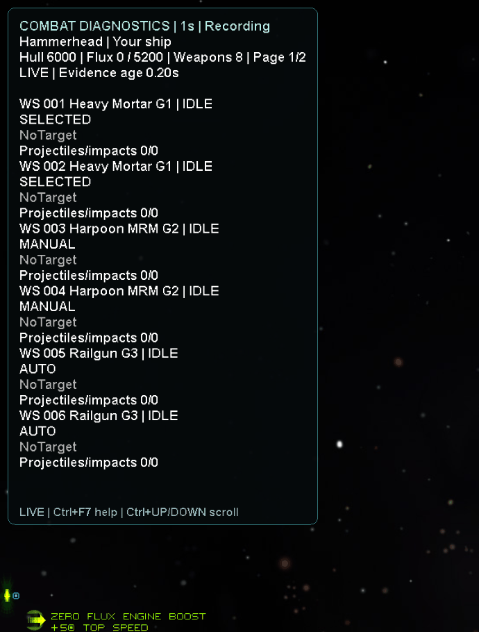

### Pin a selected ship

Use Ctrl+F9 to keep observing a selected friendly or enemy ship, then return to your controlled ship. This original clip includes one blank capture frame.

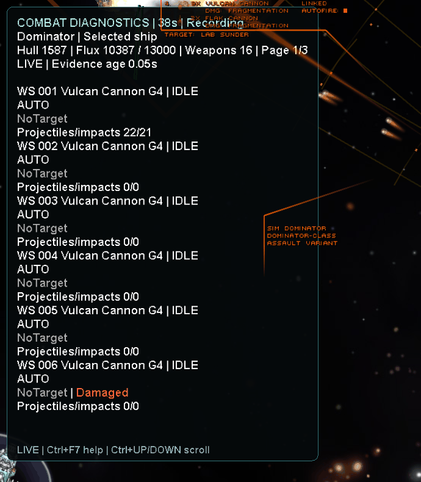

### Coloured weapon indicators

Shows simultaneous observations such as obstruction, range, cooldown, ammo and flux.
These describe observed conditions; they do not reveal the AI's private reasons or
guarantee that a weapon will fire or hit.

Show indicator GIFs and additional display examples

These 18 clips use artificial example text to demonstrate the real panel's appearance.

<strong>Blocked</strong> — An intervening ship, shield or asteroid intersects the estimated firing line. 
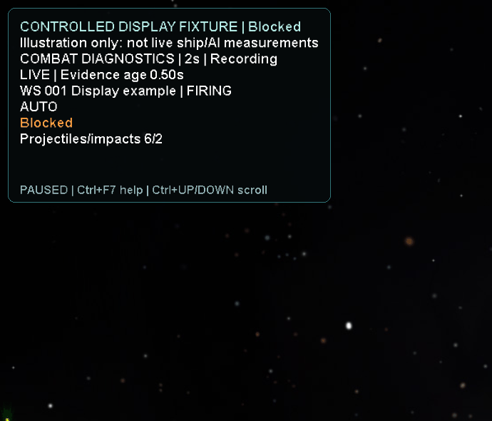

<strong>Distance</strong> — The observed target is outside the estimated weapon range. 
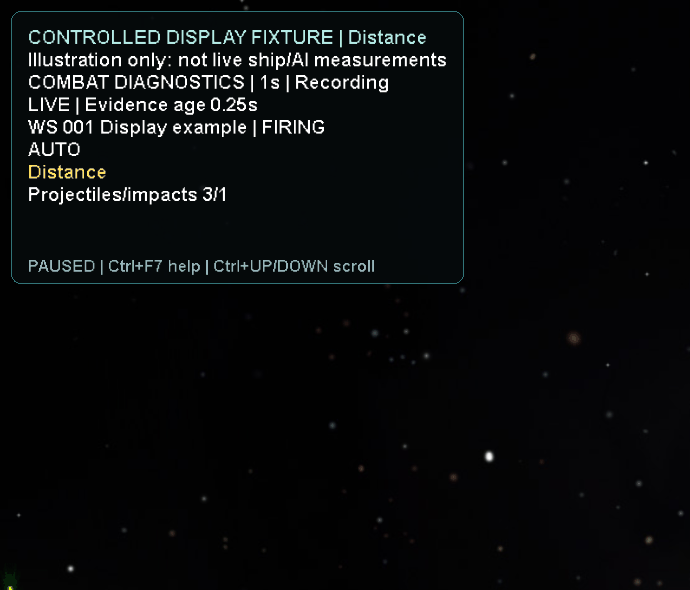

<strong>Fluxing</strong> — The ship is venting or lacks reported flux headroom. 
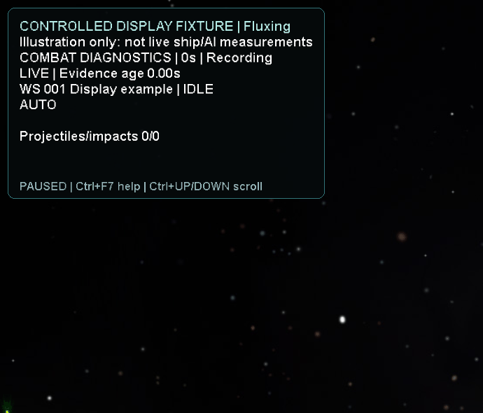

<strong>No target</strong> — No weapon target is known to the observer. 
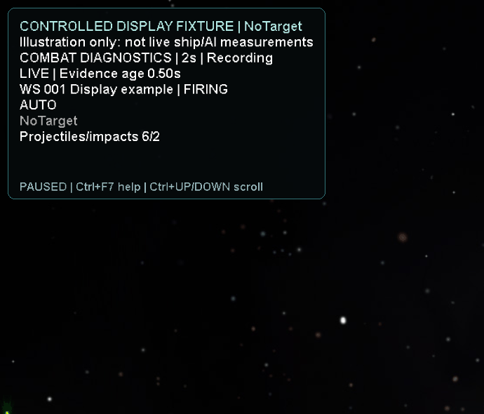

<strong>Damaged</strong> — The weapon reports being disabled. 
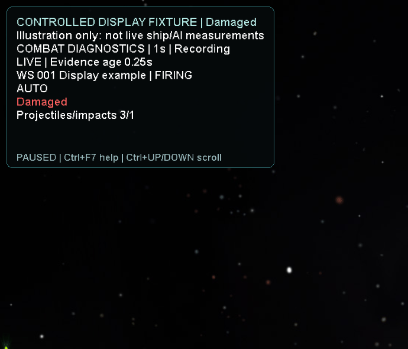

<strong>Cooldown</strong> — The weapon reports a remaining cooldown. 
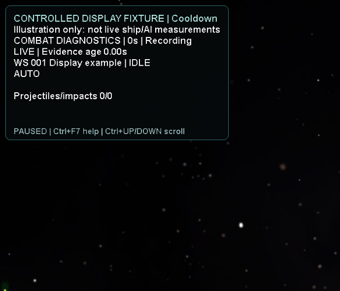

<strong>No ammo</strong> — The weapon has no ammunition remaining. 
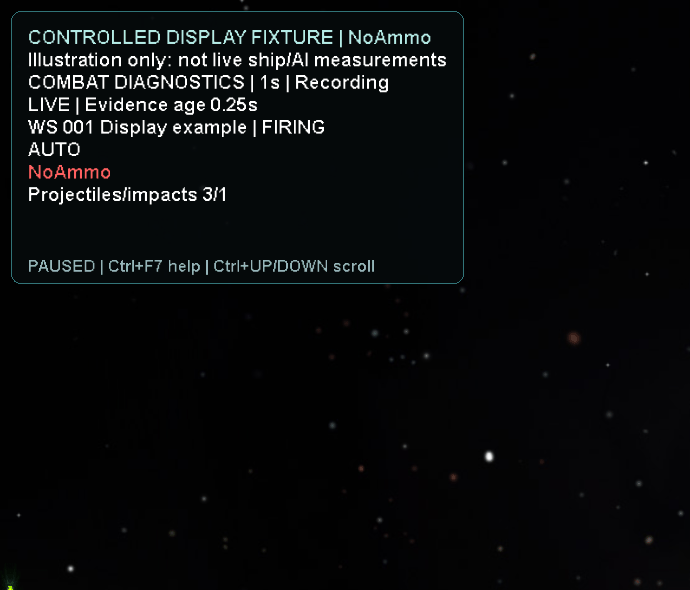

<strong>Hold</strong> — The weapon reports a forced no-fire flag. 

<strong>Arc</strong> — The observed aim point is outside the weapon arc. 
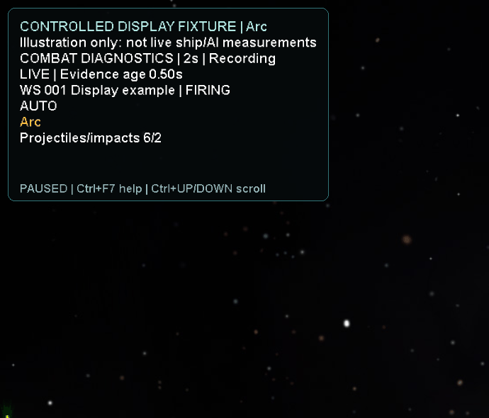

<strong>Overload</strong> — The ship is overloaded. 
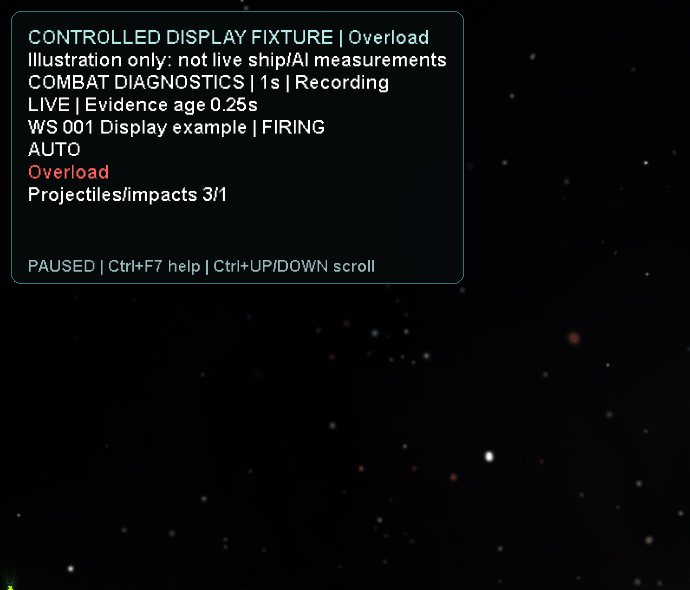

<strong>Unknown</strong> — Required evidence is missing or invalid. 

<strong>AI hold</strong> — The individual autofire request is false. 
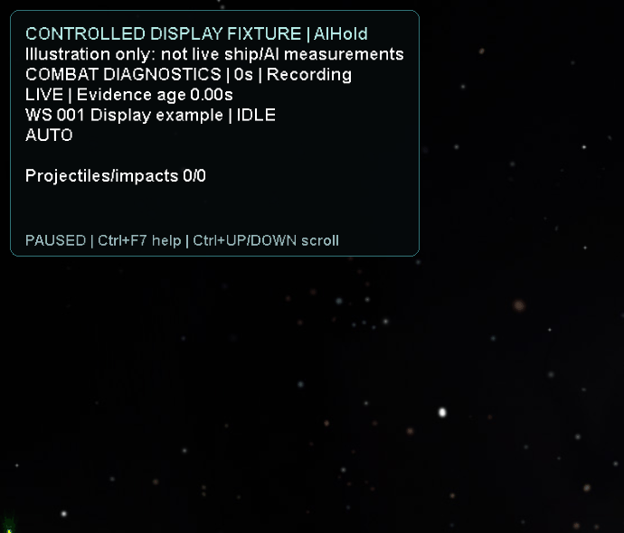

<strong>Beam counters</strong> — Shows beam firing time and frames with reported damage. 

<strong>Projectile counters</strong> — Shows observed projectiles and impacts. 

<strong>Multiple restrictions</strong> — Displays several conditions together, even alongside firing activity. 
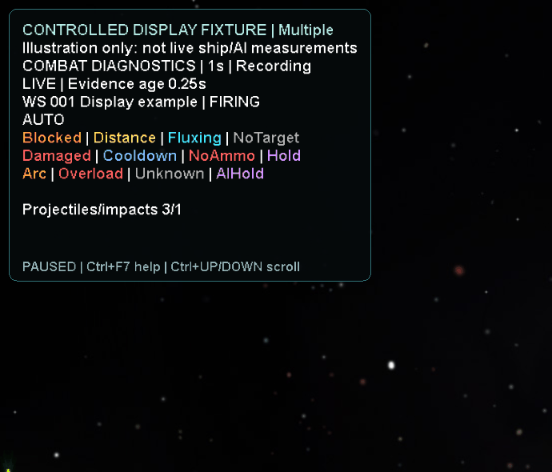

<strong>Evidence freshness</strong> — Distinguishes live, paused, final and failed observations. 

<strong>Recording status</strong> — Shows recording status and file-write warnings. 
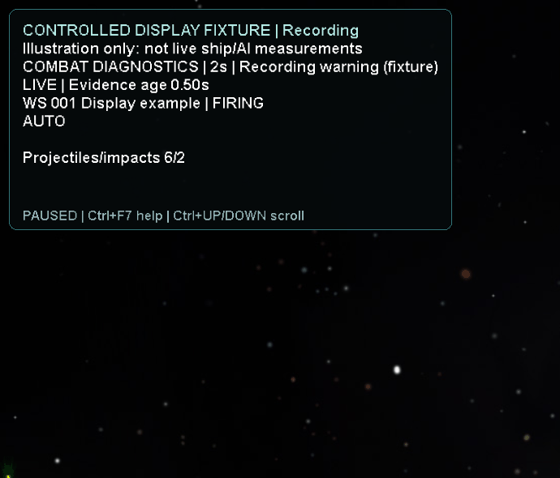

<strong>Help</strong> — Displays controls and brief recording explanations. 
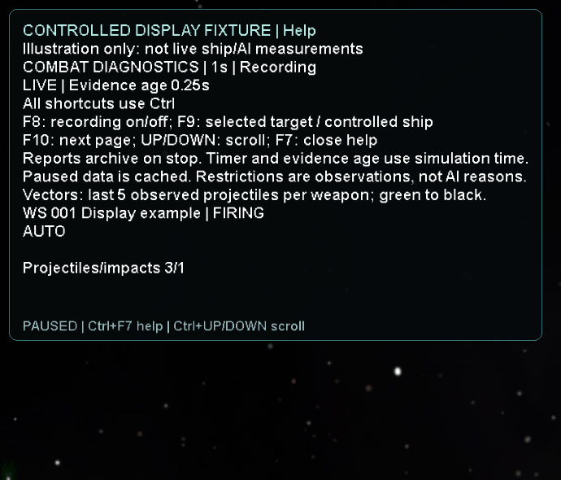

## Saved session data

Reports are saved automatically in your game installation's **`Starsector/saves/common/`** folder:

| File | Contents |
| --- | --- |
| `kayn_combat_diagnostics_live.tsv.data` | Latest snapshot, updated about once per simulation second while recording. |
| `kayn_combat_diagnostics_<session UUID>.tsv.data` | Archived measurement, saved when you stop, switch ships, lose the observed ship or combat ends. |

Reports include weapon activity, counters, target evidence and observed restrictions
for **all weapons**, regardless of the displayed page. Open these tab-separated text
files in a text editor or spreadsheet application. They do not change campaign saves.
Stop diagnostics with **Ctrl+F8** before leaving combat to request a final archive.

[Detailed usage and limitations](https://github.com/MysticEntry-Nova64/KaynCombatDiagnostics/blob/main/docs/reference.md) ·
[Build instructions](https://github.com/MysticEntry-Nova64/KaynCombatDiagnostics/blob/main/BUILD.md) ·
[Verification](https://github.com/MysticEntry-Nova64/KaynCombatDiagnostics/blob/main/TEST-RESULTS.md) ·
[MIT license](https://github.com/MysticEntry-Nova64/KaynCombatDiagnostics/blob/main/LICENSE)
