# Diagnostic GIF gallery — 1.5.0

Captured on 1 November 2026, Starsector 0.98a-RC8 / Miko Java28. GIF playback
is shortened from individual native screenshots; it is not a frame-time recording.
Game imagery remains the property of its respective owners. No game assets,
font files or test mission are included in the runtime mod ZIP.

## Live combat

These use actual observer data from ordinary ships and game AI. Counts reflect
only each measurement interval. Subject-switching clips intentionally reset.

### Projectiles Impacts

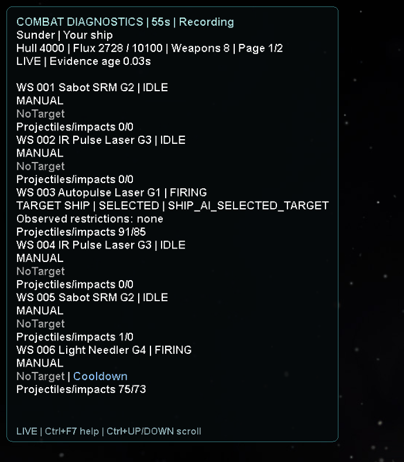

### Shot Vectors

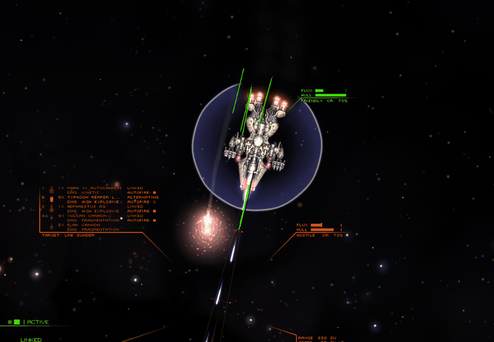

### Hull Flux Timer

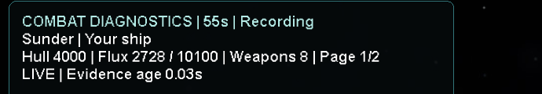

### Subject Switching

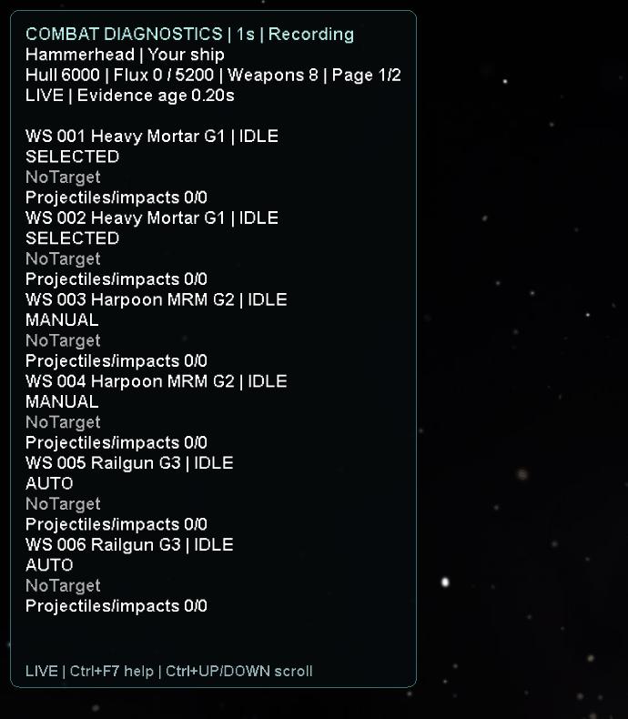

### Pages Help Pause

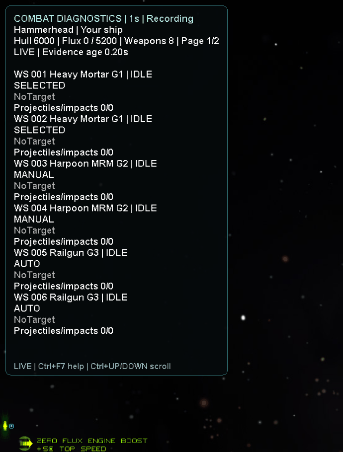

### Target Pin

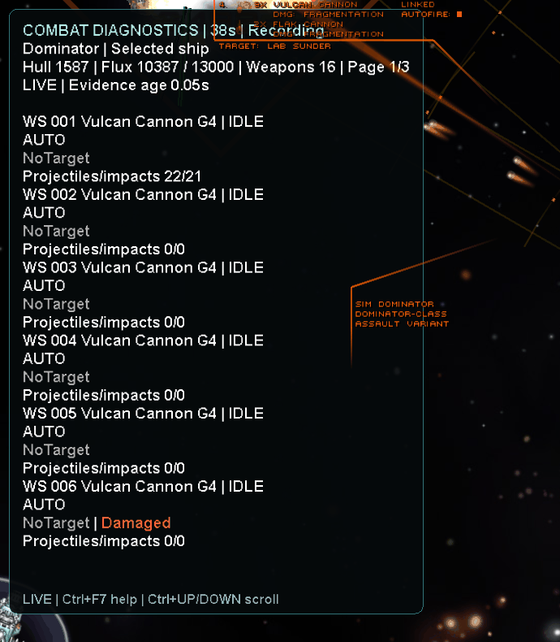

## Controlled display illustrations

These show the real label colours and board renderer with artificial example
text. They do not establish a live restriction, AI reason, counter or file error.
The illustration notice stays visible inside every clip. All restrictions are
independently tested against API fixtures in the local suite; these clips are
visual documentation only. Actual firing can coexist with observed restrictions.

### Blocked

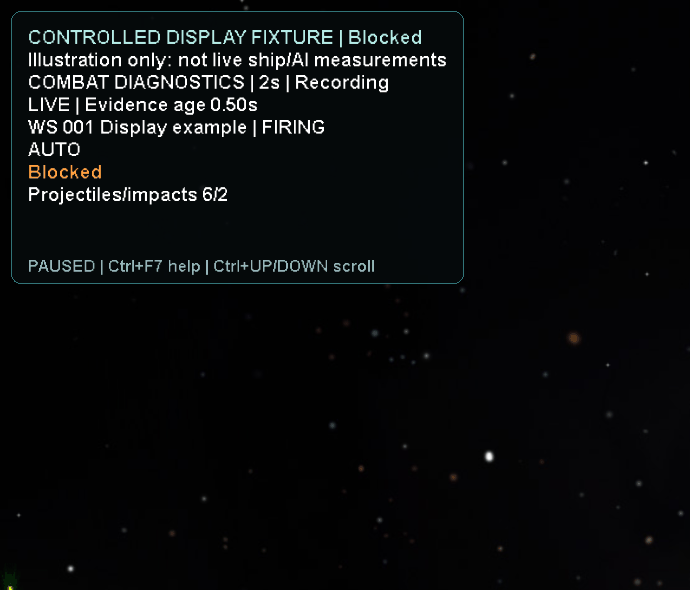

### Distance

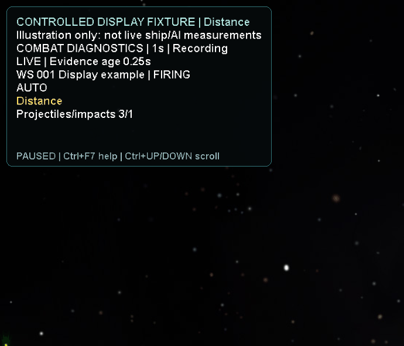

### Fluxing

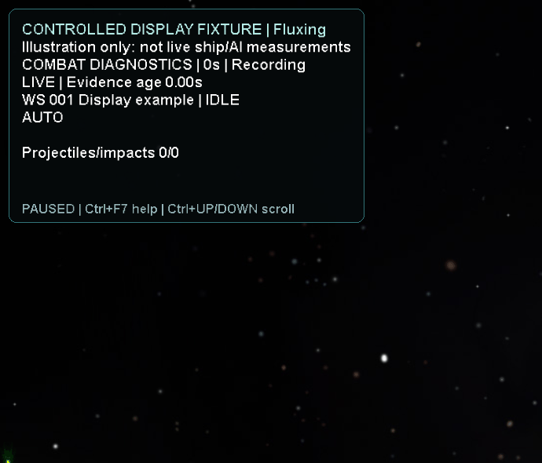

### Notarget

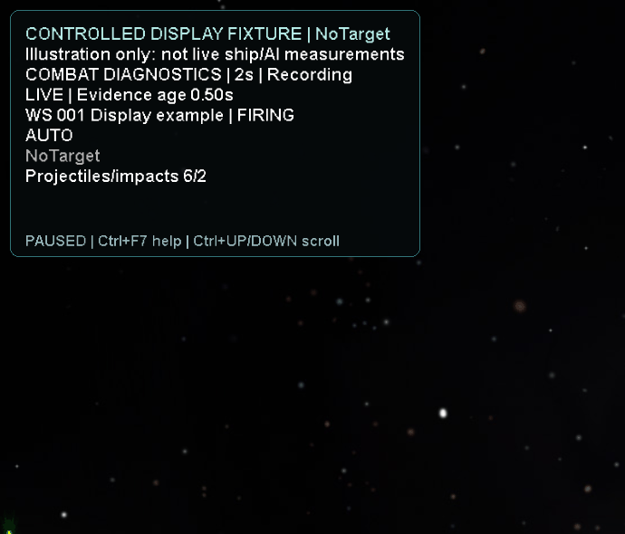

### Damaged

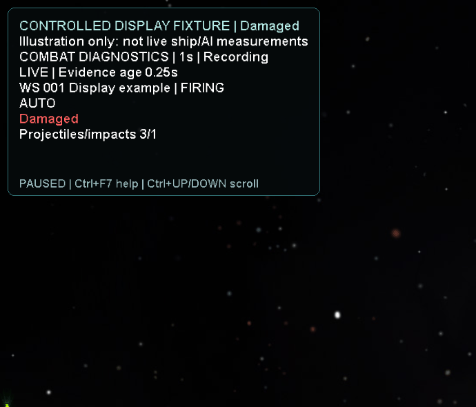

### Cooldown

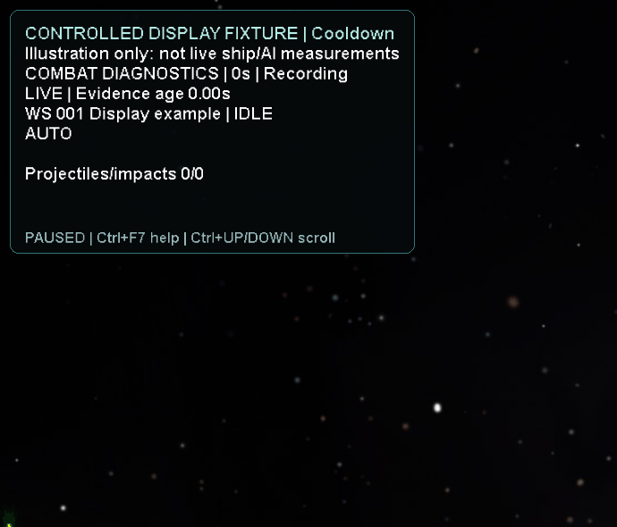

### Noammo

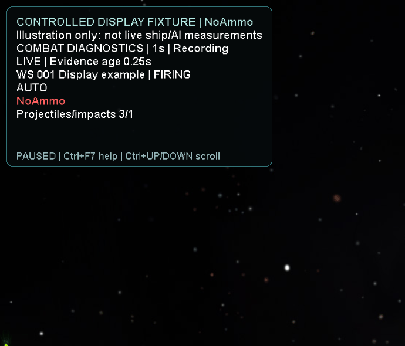

### Hold

### Arc

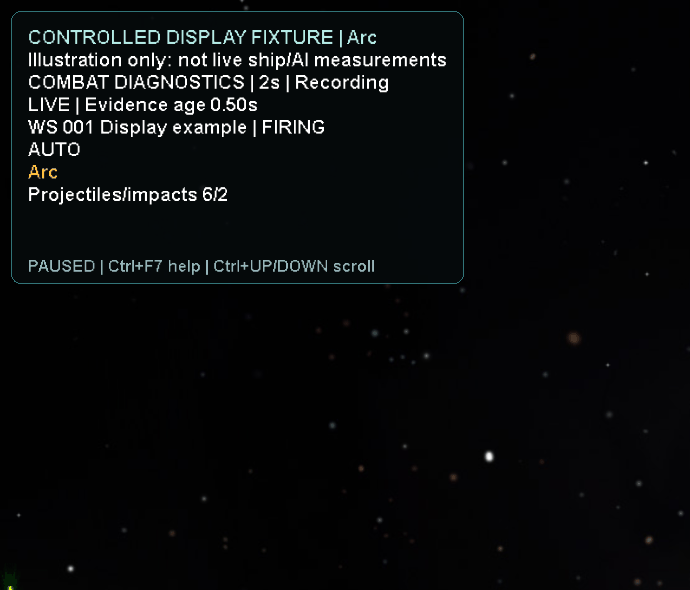

### Overload

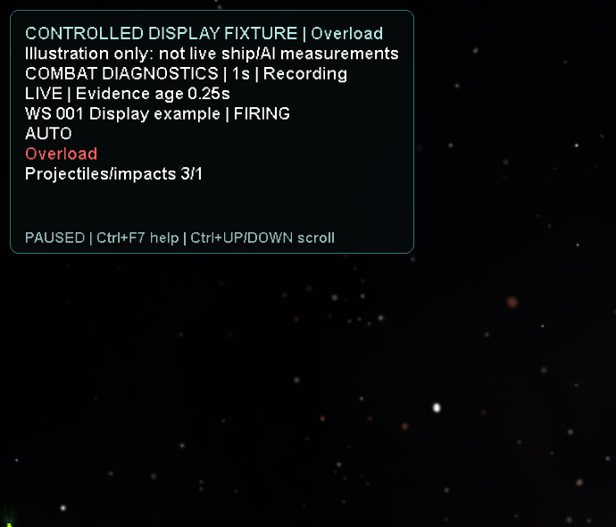

### Unknown

### Aihold

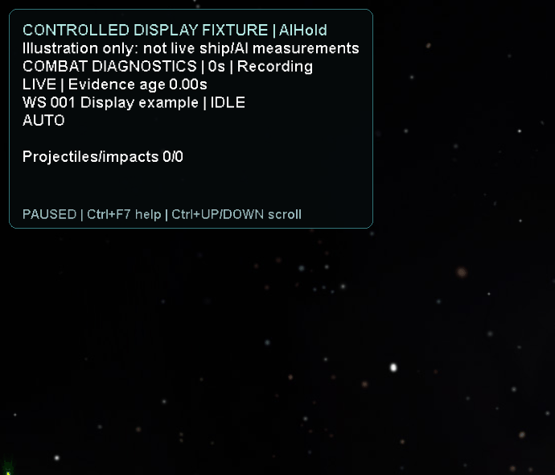

### Beam

### Projectiles

### Multiple

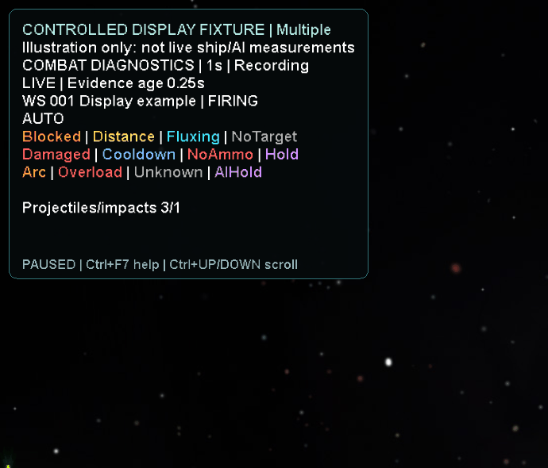

### Freshness

### Recording

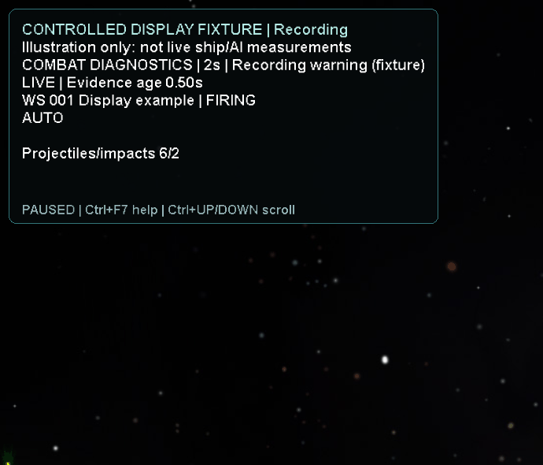

### Help

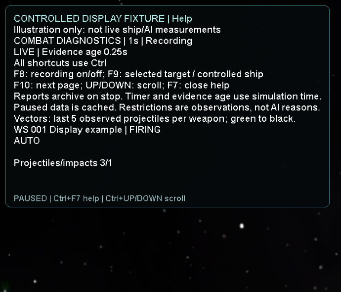
